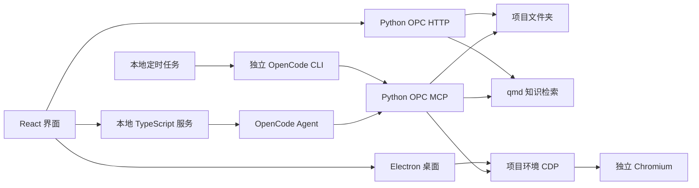

# AIOPC

AIOPC 是面向一人公司的 AI 桌面工作台。一个工作区对应一家公司，下设多个项目。背景、品牌、资料、素材、稿件和经营记录保存在本机，AI 通过本地工具读写。

桌面工作台提供项目文件与记忆、知识库、团队、任务、目标、成本、环境资源池、对话式账号登录、稿件审批与发布页填写，以及本地定时任务。

## 架构



| 目录 | 职责 |
| --- | --- |
| `apps/desktop` | Electron、窗口、更新、本地服务生命周期、项目环境浏览工具和调度入口 |
| `apps/app` | React 对话、项目、账号、资料、设置和本地 MCP Apps |
| `apps/server` | 工作区与会话、Agent runtime、本地 MCP/OAuth、文件、权限和 MCP Apps 宿主 |
| `services/opc` | Python 业务服务，MCP 和 HTTP 共用项目、账号、素材、发布与数据服务 |
| `services/qmd` | 知识库与技能库的中文全文和可选向量检索 |
| `packages/computer-use` | 浏览器操作；通过项目环境的 CDP 连接 Chromium |
| `packages/types` | 本地服务、桌面桥、权限、模型行为和 MCP Apps 的共享类型 |

已移除上游 Den 的登录、组织、云模型网关、远程会话和自动化依赖。项目环境可选择本机 Docker 或配置云浏览器提供方；两者都属于项目自己的浏览器环境。

## 项目与账号

项目可从公司资源池绑定一个或多个环境。浏览器登录状态随环境保存。本机环境使用 Docker 中的 neko Chromium；也支持 Kernel、Browserbase、Steel、Hyperbrowser、Anchor、Browser Use 和自定义 CDP 地址。环境提供方的密钥保存在系统钥匙串。

账号登录通过对话完成：AI 展示裁好的二维码，或依次询问手机号与验证码。支持的平台会检测登录身份；无法识别身份的平台明确显示“无法自动确认登录”。聊天中的普通链接交给系统浏览器打开。

项目文件通常包括 `CONTEXT.md`、`brand.md`、`MEMORY.md`、`knowledge/`、`assets/`、`content/` 和 `social/`。方法论库通过 `AIOPC_LIBRARY` 或本机配置指定，技能来自 [AIOPC-skills](https://github.com/zhangjunmengyang/AIOPC-skills)。

## 知识库

在知识库导入项目或公司资料，给媒体补充别名和来源。AI 用 `kb_query` 检索文档原文与关联媒体。qmd 支持中文全文搜索，也可配置外部 embedding。详见[知识库使用说明](docs/knowledge-base.md)。

## 稿件审批

`social_publish` 先生成对话中的稿件卡片，不填写网站。卡片显示账号、标题、正文、话题和图片缩略图。用户确认后，宿主才允许审批工具填写发布页。正文或图片改变后需要重新审批；退回和重复点击都不会重复填写。

填好后状态是“等待你点击发布”。AI 不调用平台直接发帖接口，不点击最终发布按钮。用户发布后，可以用 `social_record_published` 保存公开链接。

## 定时任务

复用 `opencode-scheduler@1.3.0`，通过本地 MCP 提供创建、查看、运行和删除任务。macOS 使用 launchd；独立 CLI 使用持久配置和独立数据库，不依赖桌面窗口或临时 HTTP 端口。后台任务可读取资料、形成监测报告和本地提醒，发布与互动登录留给用户在对话中处理。

实测记录见 [本地调度验收](docs/verification/scheduler-2026-11-12/README.md)。Windows 调度尚未验收，不把它列为已验证能力。

## 开发

需要 Node 24.22.1 及以上的 24.x、pnpm 11、Python 3.11+ 和 uv；使用本机项目环境时还需要运行中的 Docker Desktop 或 OrbStack。

```sh
pnpm install
pnpm dev
```

常用检查：

```sh
pnpm --filter @openwork/types build
pnpm --filter @openwork/app typecheck
pnpm --filter openwork-server typecheck
cd services/opc
UV_PROJECT_ENVIRONMENT=~/.aiopc/venv uv run pytest -q
UV_PROJECT_ENVIRONMENT=~/.aiopc/venv uv run ruff check aiopc tests
```

模型可配置原生 Gemini、Anthropic 或 OpenAI 兼容接口。模型目录、运行时配置和凭据保存在本机。

后续页面和数字员工安排见 [下一步](docs/product/next.md)，本轮实测见 [收尾验收](docs/verification/closeout-2026-11-12.md)。

## 致谢与许可

基于 [OpenWork](https://github.com/different-ai/openwork)（MIT）开发，导入自 `different-ai/openwork@0d06aff4`；同步上游以此提交为基准。发布页填写复用 MultiPost（Apache-2.0），调度复用 opencode-scheduler。原项目版权声明保留在 [LICENSE](LICENSE) 中。
