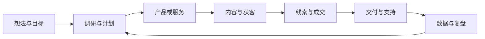

# 下一步

项目文件夹继续作为业务记录的来源。下一阶段把四位数字员工、待审事项和经营结果放进同一条工作流程；以下是设计安排，尚未全部实现。

| 数字员工 | 负责什么 | 交接的产物 | 用户拍板的事项 |
| --- | --- | --- | --- |
| 经营助理 | 整理目标、计划、待办、决策与经营记录 | 项目简报、每周计划、待审清单 | 目标、预算、取舍 |
| 产品交付 | 调研需求，制作产品、服务和交付物 | 调研结论、方案、可检查的成果 | 范围、对外承诺、交付验收 |
| 内容运营 | 选题、稿件、素材、发布填写和数据复盘 | 稿件卡片、素材、发布链接、复盘 | 稿件确认、平台最终发布 |
| 销售客服 | 线索、报价、跟进、收款记录和支持 | 客户记录、报价、跟进计划、服务记录 | 价格、合同承诺、退款 |

员工属于项目，可按项目启用。交接必须指向文件、卡片或记录，不能只有一段“已完成”的聊天回复。

| 页面 | 用户要看见什么 | 当前状态与顺序 |
| --- | --- | --- |
| 项目首页 | 目标、下一步、等待用户决定的事项 | P1：补待审入口和业务进度；不再展示上游云组织页面 |
| 对话 | 当前员工、正在做什么、产物、需要确认的决定 | 已有本地会话与稿件审批；P1：把其他决定也放进对应结果卡片 |
| 知识库 | 文档、图片、来源、关联、可解释的搜索结果 | P0：下一项，先选用可嵌入的开源检索组件，再接统一查询工具 |
| 数字员工 | 各员工职责、当前任务、完成产物、等待事项 | P1：做项目团队配置和任务交接 |
| 内容 | 草稿、审核状态、素材、发布后链接 | 已完成审批到填写；P1：让历史稿件有稳定入口 |
| 客户与交付 | 线索、报价、订单、收款、交付和支持记录 | P2：先建立本地记录和人工确认，不预设自动交易 |
| 复盘 | 实际发布、线索、收入与下一轮动作 | P2：从可验证的数据开始，不把生成内容数当作经营结果 |

审批留在产物旁边。内容先审稿，再填发布页，最后由用户在平台点击发布；价格、预算、对外承诺和交付也各有自己的确认记录。后台任务生成报告或提醒，不代替这些决定。

排期：完成工程收尾后先做知识库，然后做项目首页的待审事项与四员工协作，再补客户、订单、交付记录。支付接入和自动成交需基于实际业务验证。
